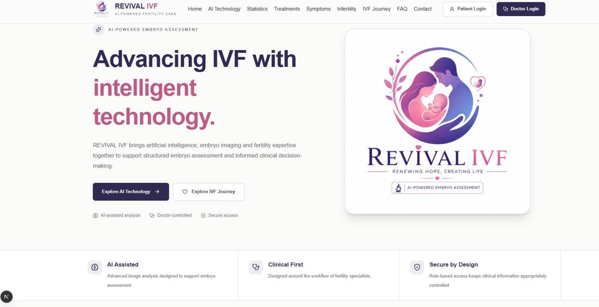
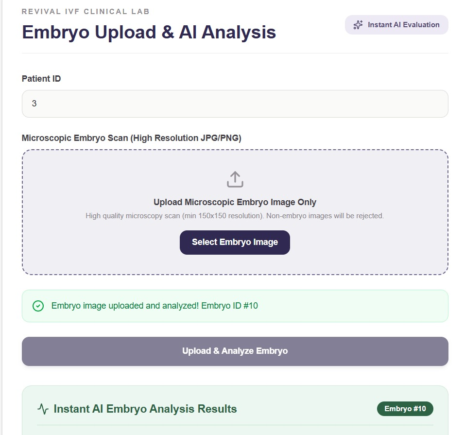
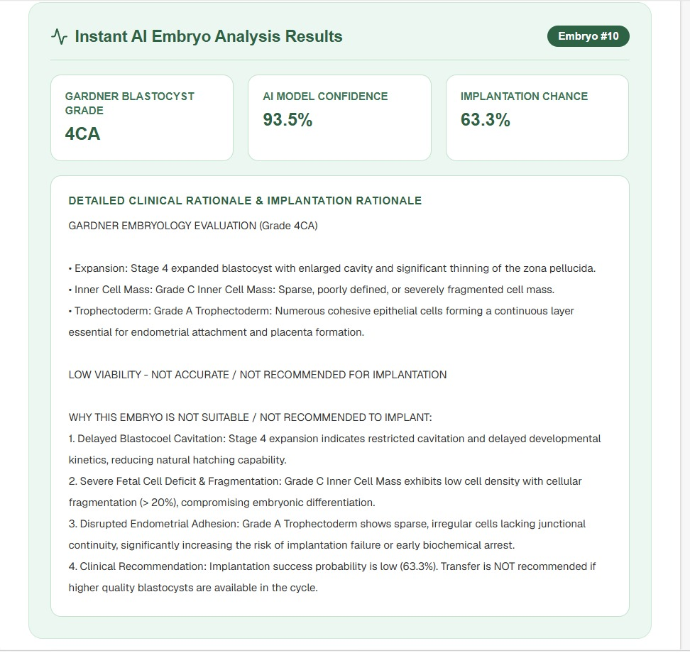
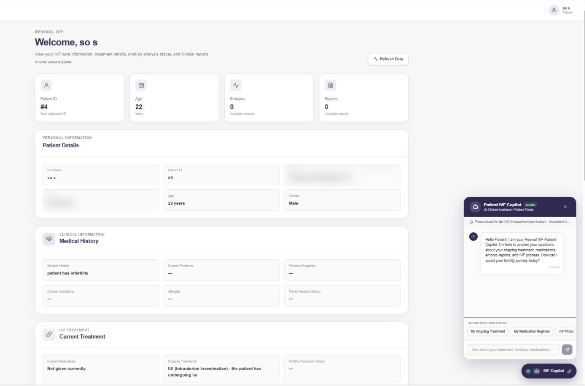
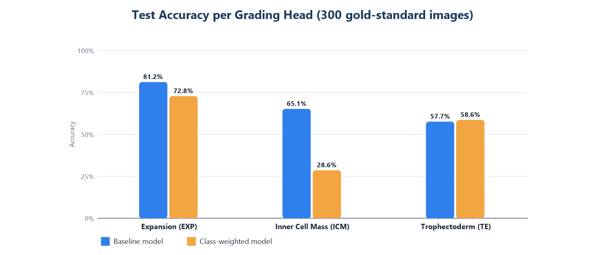
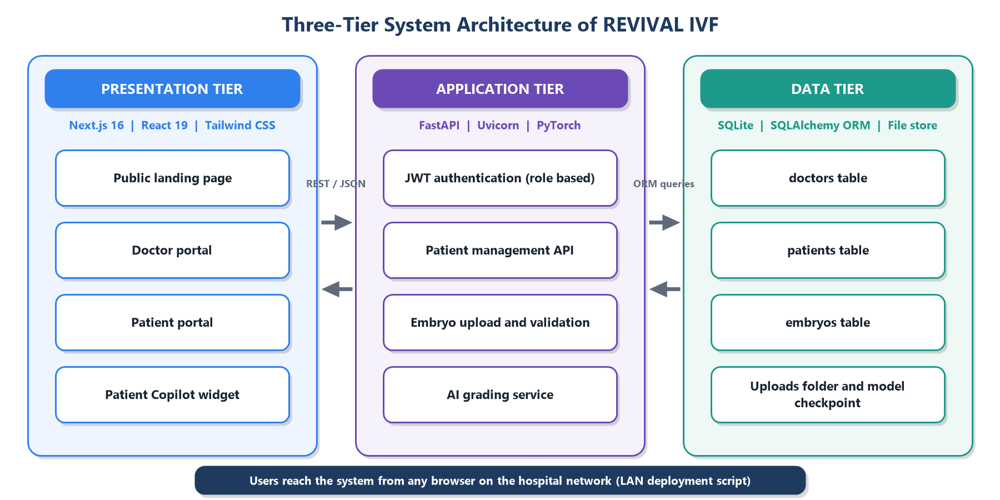

# REVIVAL IVF: AI-Assisted Embryo Selection

> Final-year major project (B.E. Artificial Intelligence & Machine Learning, VTU, 2026-27).
> A deep learning model that grades IVF blastocyst images, delivered as a secure web platform for doctors and patients.



## Why this project?

Choosing the best embryo is one of the most important steps in IVF. Today, embryologists grade embryos by eye under a microscope, which is slow and can differ from one person to another. This project grades a blastocyst image automatically using the standard **Gardner system** (for example, `4AA`) and gives the clinic a consistent, documented second opinion.

> **Disclaimer:** This is an academic research prototype. It is a decision-support tool and not a medical device. Every grade must be reviewed by a qualified embryologist.

## What it does

- Predicts the **three Gardner components** from a single microscope image: **expansion**, **inner cell mass (ICM)** and **trophectoderm (TE)**, then combines them into one grade.
- Shows the grade, model confidence and a written explanation for each component.
- **Doctor portal:** manage patients, upload embryo images, run the analysis and review reports.
- **Patient portal:** patients see only their own records and reports, with a **Patient Copilot** that answers questions from their own record.
- **Secure by design:** role-based access (doctor / patient), JWT login, bcrypt-hashed passwords and image validation.

## Screenshots

| Upload an embryo image | AI analysis result |
|---|---|
|  |  |

**Patient dashboard with Patient Copilot** (demo data, personal details hidden)



## Model and results

| | |
|---|---|
| **Model** | Multi-output CNN: ResNet-18 (ImageNet pre-trained) with three classification heads |
| **Training data** | 2,044 annotated human blastocyst images (individual embryologist labels) |
| **Test data** | 300 images labelled by an expert panel (gold standard), never used in training |
| **Training** | Transfer learning, data augmentation, AdamW, batch size 16, 10 epochs, learning rate 0.0001 |
| **Dataset** | Public blastocyst dataset by Kromp et al., *Scientific Data*, 2023 |

**Test accuracy (baseline model, expert-labelled test set):**

| Grading head | Test images | Accuracy |
|---|---|---|
| Expansion | 298 | **81.21%** |
| Inner Cell Mass (ICM) | 238 | **65.13%** |
| Trophectoderm (TE) | 234 | **57.69%** |



**Key findings**

- Expansion is easiest to predict, and almost all its errors fall on a neighbouring class (only 3 of 298 images were two or more classes away).
- ICM and TE are harder, since they depend on fine cell detail and human experts also disagree on them.
- **Class imbalance is the main limitation.** A class-weighted loss raised the recall of a rare expansion class from 0% to 80%, but lowered overall accuracy, so the unweighted baseline is reported as the main result.
- Future work: milder class weights for ICM, more grade C examples, and stronger backbones (EfficientNet, ConvNeXt, ViT).

## System architecture

Three-tier design: **Next.js** frontend, **FastAPI** backend with the AI grading service, and **SQLite** database.



## Tech stack

| Area | Tools |
|---|---|
| AI / ML | Python, PyTorch, torchvision, scikit-learn, pandas, NumPy, Pillow |
| Backend | FastAPI, Uvicorn, SQLAlchemy, SQLite, python-jose (JWT), bcrypt |
| Frontend | Next.js, React, TypeScript, Tailwind CSS |
| Tools | Git, GitHub, VS Code |

## Project structure

```
revival_ivf/
  ai/            # dataset, training scripts (train.py, test.py), model outputs
  backend/       # FastAPI app: main.py, ai_model.py, auth.py, database.py, models.py
  frontend/      # Next.js app: doctor and patient portals, landing page
  start-network-app.ps1   # one-click launcher for the local network
```

## How to run

**1. Backend**

```bash
cd backend
pip install -r requirements.txt
uvicorn main:app --host 0.0.0.0 --port 8000
```

**2. Frontend** (in a second terminal)

```bash
cd frontend
npm install
npm run dev
```

Open the address shown in the terminal (usually `http://localhost:3000`).

**3. Train the model (optional)**

```bash
cd ai
python train.py     # baseline model
python test.py      # class-weighted model
```

The dataset images and annotation files go in `ai/dataset/`.

## Testing

12 test cases cover login, wrong password, role-based access (403 errors), image validation (wrong file type, blank image, image too small), missing patients, and access from a second device on the same network.

## Team

| Name | USN |
|---|---|
| Chandushree J B | 4YG23AI011 |
| Prajwal H R | 4YG23AI037 |
| Shalini B A | 4YG23AI047 |
| Sonali C | 4YG23AI050 |

**Guide:** Ms. T R Usha, Assistant Professor, Dept. of AI & ML, Navkis College of Engineering, Hassan (VTU).

## Acknowledgements

Dataset: F. Kromp et al., "An annotated human blastocyst dataset to benchmark deep learning architectures for in vitro fertilization," *Scientific Data*, vol. 10, 271, 2023.

